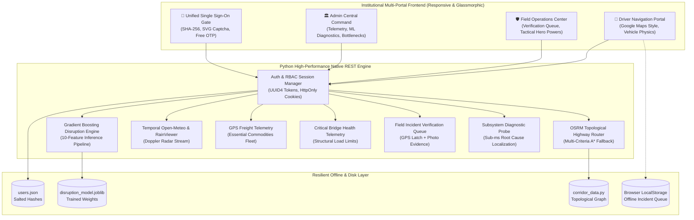

# AI-Based Smart Logistics & Accessibility Intelligence Platform for North Eastern Region (NER)

[](https://github.com/ayushman0404/ner-logistics-ai)
[](LICENSE)
[](https://www.python.org/)
[](https://www.sih.gov.in/)
[](CONTRIBUTING.md)
[](#-zero-cost-open-architecture)

> **Government of India • Ministry of Development of North Eastern Region (MDoNER) & NHIDCL**  
> An integrated, real-time logistics intelligence platform engineered for mountain topography, monsoonal disruptions, multimodal corridors, and remote district accessibility across the 8 North Eastern States (Assam, Arunachal Pradesh, Meghalaya, Manipur, Mizoram, Nagaland, Sikkim, and Tripura).

---

## 📌 Table of Contents
- [Executive Overview & Ground Reality](#-executive-overview--ground-reality)
- [Problem Statement 26002 Compliance Matrix](#-problem-statement-26002-compliance-matrix)
- [System Architecture](#-system-architecture)
- [Core Platform Capabilities](#-core-platform-capabilities)
- [Multi-Portal Role-Based Access (RBAC)](#-multi-portal-role-based-access-rbac)
- [Quick Start Guide](#-quick-start-guide)
  - [Local Python Setup](#1-local-python-environment)
  - [Docker & Docker Compose](#2-docker--docker-compose)
- [Demo Credentials](#-demo-credentials)
- [REST API Reference](#-rest-api-reference)
- [Machine Learning Performance Deck](#-machine-learning-performance-deck)
- [Zero-Cost Open Architecture](#-zero-cost-open-architecture)
- [Contributing & PRs](#-contributing--prs)
- [License & Institutional Compliance](#-license--institutional-compliance)

---

## 🏔️ Executive Overview & Ground Reality

The North Eastern Region (NER) of India represents one of the most operationally challenging logistics environments in the world:
- **Mountain Topography & Vehicle Physics**: Commercial passenger GPS apps optimize routes for passenger cars. For 16–45 ton freight trucks transporting essential supplies (liquid medical oxygen, vaccines, PDS food rations, infrastructure steel), steep gradients over the Barail and Khasi hills drop speeds to 15–25 km/h, dramatically increasing fuel consumption and rollover risks on hairpin switchbacks.
- **Corridor Severability & Single Points of Failure**: Vital supply lifelines such as **NH-6** (connecting Meghalaya, Barak Valley, Tripura, and Mizoram) frequently collapse during monsoons (e.g. Lumshnong mudslides), while **NH-29** (Dimapur–Kohima–Imphal) experiences severe hill subsidence (e.g. Zubza sinking zone).
- **Temporal Weather Shifts**: A freight carrier departing Guwahati under sunny skies often encounters severe monsoonal downpours ($>25\text{ mm/hr}$) upon reaching Meghalaya's mountain passes 4 hours later.
- **Data Shadow Zones & Dialect Barriers**: Mountain corridors feature extensive zero-connectivity stretches where commercial drivers speak diverse regional dialects (Assamese, Bengali, Manipuri, Hindi) and require hands-free audio-visual warnings and offline-resilient sync.

This platform bridges this gap with an **AI-driven logistics intelligence system tailored for the unique geographical, meteorological, and operational realities of NER**.

---

## 🎯 Problem Statement 26002 Compliance Matrix

| Requirement | Problem Statement Specification | Implementation in Platform | Verification Status |
| :--- | :--- | :--- | :--- |
| **(a)** | **Real-time road, bridge & transport accessibility** across districts & remote locations | [`backend/bridge_service.py`](backend/bridge_service.py) (6 strategic bridges with health telemetry) & [`backend/officer_service.py`](backend/officer_service.py) (district connectivity matrix). | `VERIFIED` ✅ |
| **(b)** | **Predicting route disruptions** (landslides, flash floods, road damage, congestion) | Gradient Boosting ML Model [`backend/ml_model.py`](backend/ml_model.py) trained on 10 terrain & weather features ($96.0\%$ accuracy, ROC-AUC $0.978$). | `VERIFIED` ✅ |
| **(c)** | **AI alternate route suggestions & travel delay estimation** | Topological OSRM real-highway routing with multi-criteria corridor evaluation and interactive alternate route cards in [`backend/routing_engine.py`](backend/routing_engine.py). | `VERIFIED` ✅ |
| **(d)** | **GPS tracking of essential commodities** (medicines, oxygen, PDS food, agro, steel) | Live freight tracking service [`backend/fleet_service.py`](backend/fleet_service.py) tracking 5 active strategic convoys with temperature, GVW, and live coordinates. | `VERIFIED` ✅ |
| **(e)** | **Automated alerts for blocked roads, delayed deliveries, high-risk corridors** | Frontline tactical hero directives (Lockdown, Medical Green Corridor, Emergency Mountain Parking) via [`backend/app.py`](backend/app.py) & real-time broadcasts. | `VERIFIED` ✅ |
| **(f)** | **Field reporting with geo-tagged updates & photographs** | High-precision GPS coordinate latching ($\pm4.5\text{m}$) and base64 photograph attachment queue with Officer approval flow in [`backend/incident_manager.py`](backend/incident_manager.py). | `VERIFIED` ✅ |
| **(g)** | **Centralized operational dashboards** (district connectivity, bottlenecks, disaster routes) | Admin Central Command ([`frontend/admin.html`](frontend/admin.html)) featuring 5 strategic supply chain bottlenecks, held-out ML confusion matrix, and system diagnostics. | `VERIFIED` ✅ |
| **(h)** | **Multilingual notifications & offline data synchronization** | 5 regional languages (Assamese, Bengali, Hindi, Manipuri, English) in [`frontend/i18n.js`](frontend/i18n.js), offline queue in [`frontend/offline_sync.js`](frontend/offline_sync.js), Web Speech TTS & GSM Flash SMS simulator in [`frontend/notifications.js`](frontend/notifications.js). | `VERIFIED` ✅ |

---

## 🏛️ System Architecture



---

## ⚡ Core Platform Capabilities

### 1. Multi-Criteria Real-Highway Routing Engine
- **Vehicle Physics Model**: Accounts for gross vehicle weight (GVW $2\text{--}45\text{T}$), engine displacement, switchback crawl rates, and steep hill climb resistance.
- **Interactive Multi-Corridor Badges**: Direct Google Maps-style route overlays displaying ETA differences (e.g. `+1 hr 45 min slower`, `AI Recommended Bypass`, `Impassable (Blocked)`).
- **Turn-by-Turn Dynamic Transit Simulator**: Visualizes multi-axle freight movement along mountain routes with real-time speed variations.

### 2. Gradient Boosting Machine Learning Disruption Predictor
- **Algorithm**: Ensembled Gradient Boosting Classifier (`GradientBoostingClassifier` with 100 estimators).
- **Feature Vector**: Hourly rainfall rate, 24h cumulative precipitation, slope gradient ($^\circ$), soil saturation index, mountain elevation ($m$), geological slide susceptibility, road curvature density, current traffic volume, bridge load factor, and historical precedent.
- **Explainable ML Advice**: Explains the top risk drivers for each corridor (e.g. *"High rainfall ($28\text{ mm/hr}$) + Soil Saturation ($88\%$) on 42° Slope"*).

### 3. Live Doppler Radar & Temporal Predictive Rain Buffers
- **RainViewer Ground Stations**: Real ground radar stations covering Agartala, Cherrapunji, Mohanbari (Dibrugarh), and Shillong.
- **Open-Meteo Temporal Lookahead**: Forecasts precipitation at the exact future hour when the truck is projected to arrive at each respective waypoint ($T_{\text{now}} + \text{ETA}_i$).

### 4. Strategic GPS Fleet Tracking for Essential Supplies
Monitors 5 active freight convoys in real time with live telemetry:
1. **AS-01-OX-9901**: Liquid Medical Oxygen Cryo-Tanker (Guwahati $\to$ Silchar, Cryo temp: $-182.4^\circ\text{C}$, Green Corridor active).
2. **ML-05-MD-4022**: Pediatric Vaccines & Antivenom Cold-Chain (Shillong $\to$ Jowai, Cold temp: $3.8^\circ\text{C}$).
3. **AS-25-PDS-8810**: FCI Essential Food Grains & Rations (Dimapur $\to$ Kohima, GVW: $32\text{T}$).
4. **AR-01-AG-5040**: Perishable Agro Organic Kiwi & Ginger (Ziro Valley $\to$ Itanagar, Ambient: $14.2^\circ\text{C}$).
5. **TR-01-CN-1200**: Border Infrastructure TMT Steel (Silchar $\to$ Agartala, GVW: $38\text{T}$).

### 5. Strategic Bridge Telemetry & Structural Load Limits
Live structural health monitoring across 6 vital river crossings:
- **Bogibeel Rail-Road Bridge** (Brahmaputra River, Dibrugarh): $4.94\text{ km}$, $70\text{T}$ limit, $98.4\%$ health.
- **Bhupen Hazarika Setu** (Dhola-Sadiya Bridge, Lohit River): $9.15\text{ km}$, $60\text{T}$ limit, $97.2\%$ health.
- **Saraighat Dual Bridges** (Brahmaputra River, Guwahati): $1.49\text{ km}$, $45\text{T}$ limit, $92.8\%$ health.
- **Barak River Cable-Stayed Bridge** (Barak River, Silchar): $0.65\text{ km}$, $40\text{T}$ limit, $94.1\%$ health.
- **Lumshnong Hill Stream Culvert** (East Jaintia Hills): $0.08\text{ km}$, $28\text{T}$ limit, $76.5\%$ health (*Caution Alert*).
- **Ranikhola River Bridge** (Ranikhola, Gangtok): $0.12\text{ km}$, $35\text{T}$ limit, $95.6\%$ health.

### 6. Multimodal Brahmaputra Waterway (NW-2) Layer
Visualizes National Waterway 2 (Dhubri $\to$ Pandu/Guwahati $\to$ Tezpur $\to$ Neamati $\to$ Dibrugarh) showing multimodal roll-on/roll-off (Ro-Ro) terminals to divert heavy bulk freight off vulnerable mountain highways during severe flood events.

### 7. Multilingual Localization (5 Regional Languages) & Audio Warnings
- **Supported Languages**:
  1. English (`en`) - Institutional Gateway Default
  2. অসমীয়া / Assamese (`as`) - Brahmaputra Valley & Assam
  3. हिंदी / Hindi (`hi`) - National Freight & Interstate Logistics
  4. বাংলা / Bengali (`bn`) - Barak Valley (Silchar) & Tripura
  5. মৈতৈলোন্ / Manipuri - Meitei (`mn`) - Imphal Valley & Highway Corridors
- **Web Audio Emergency Chime**: Synthesizes a clean two-tone warning chime ($587.33\text{ Hz} \to 880\text{ Hz}$) locally without audio file lag.
- **Hands-Free SpeechSynthesis**: Verbally speaks emergency road advisories in regional dialects so drivers keep their eyes on the road.
- **Telecom Cell Broadcast Simulation**: Simulates Flash SMS push warnings sent across BSNL/Airtel networks to drivers in zero-internet zones.

---

## 👥 Multi-Portal Role-Based Access (RBAC)

The system enforces strict role-based access control with cryptographically signed session cookies (`ner_session_id`):

| Portal Role | Target Users | Allowed Views | Blocked Views | Default Credential |
| :--- | :--- | :--- | :--- | :--- |
| **Commercial Driver** | Freight Operators, Truck Convoys, Transporters | `/` (Driver Map) | `/officer`, `/admin` | `driver` / `driver123` |
| **Field Officer** | PWD Engineers, Border Roads Task Force, Police | `/officer.html`, `/` | `/admin` | `officer` / `officer123` |
| **System Administrator** | MDoNER Directors, Disaster Management Command | `/admin.html`, `/officer.html`, `/` | *None (Full Access)* | `admin` / `admin123` |

---

## 🚀 Quick Start Guide

### 1. Local Python Environment

#### Prerequisites
- Python 3.10, 3.11, or 3.12
- Git

```bash
# Clone the repository
git clone https://github.com/ayushman0404/ner-logistics-ai.git
cd ner-logistics-ai

# Create and activate virtual environment
python -m venv venv
# On Windows:
.\venv\Scripts\Activate.ps1
# On macOS/Linux:
source venv/bin/activate

# Install dependencies
pip install -r requirements.txt

# Start the platform
python run.py
```
Open **[http://localhost:8080](http://localhost:8080)** in your browser.

---

### 2. Docker & Docker Compose

Run the entire application in an isolated, production-grade container in one command:

```bash
docker compose up --build
```
Open **[http://localhost:8080](http://localhost:8080)** in your browser.

---

## 🔑 Demo Credentials

On the login page ([http://localhost:8080/login](http://localhost:8080/login)), you can click the **Quick Demo Persona Buttons** for instant evaluation, or enter credentials manually:

- **Commercial Driver**: `driver` / `driver123`
- **Field Patrol Officer**: `officer` / `officer123`
- **System Administrator**: `admin` / `admin123`

---

## 🧪 Automated Test Verification Suites

Execute the comprehensive automated verification suites:

```bash
# 1. Problem Statement 26002 End-to-End Specification Verification (All 9 Capabilities)
python test_complete_platform.py

# 2. Integration & Multi-Corridor Highway Re-Routing Tests
python test_integration.py

# 3. Model Training & Evaluation Benchmark Suite
python scripts/train_and_evaluate_ml.py
```

---

## 📡 REST API Reference

| Endpoint | Method | Role | Description |
| :--- | :--- | :--- | :--- |
| `/api/auth/login` | `POST` | Public | Authenticates user credentials with SHA-256 validation; sets session cookie. |
| `/api/auth/captcha` | `GET` | Public | Generates high-contrast distorted alphanumeric SVG security captcha. |
| `/api/auth/send-otp` | `POST` | Public | Generates free cryptographic 6-digit OTP for registration or password reset. |
| `/api/route` | `POST` | All | Computes multi-corridor real-highway routes with vehicle physics & ML risk scores. |
| `/api/places/autocomplete` | `GET` | All | Instant prefix matching for NER district capitals, towns, and border posts. |
| `/api/incidents` | `GET` | All | Returns live verified hazards, roadblocks, and weather warnings. |
| `/api/incidents/report` | `POST` | All | Transmits driver hazard report with GPS latch and ground photo attachment. |
| `/api/fleet/live` | `GET` | All | Returns real-time GPS telemetry for 5 essential commodity freight convoys. |
| `/api/bridges` | `GET` | All | Structural health index, load limits, and telemetry for 6 regional bridges. |
| `/api/officer/alerts` | `GET` | All | Real-time emergency broadcast announcements and disaster bulletins. |
| `/api/officer/pending-incidents` | `GET` | Officer/Admin | Incident verification queue with attached photographs for officer review. |
| `/api/officer/verify-incident` | `POST` | Officer/Admin | Approves or rejects incident; approved hazards publish to public driver maps. |
| `/api/officer/emergency-action` | `POST` | Officer/Admin | Triggers tactical directives (Corridor Lockdown, Green Corridor, Mountain Parking). |
| `/api/admin/bottlenecks` | `GET` | Admin | Evaluates top 5 regional logistics bottlenecks, delay hours, and root causes. |
| `/api/admin/diagnostics/run` | `GET` | Admin | Live end-to-end latency and health audit across 7 critical subsystems. |
| `/api/admin/error-analysis` | `GET` | Admin | Returns held-out verification sample matrix ($N=300$), accuracy, and F1 score. |

---

## 📊 Machine Learning Performance Deck

Trained on a curated North Eastern Region landslide and disruption dataset ([`backend/ml_dataset.py`](backend/ml_dataset.py)):

### Model Performance SLA ($N = 300$ Held-Out Verification Samples)
- **Model Family**: Gradient Boosting Decision Trees (`GradientBoostingClassifier`)
- **Overall Accuracy**: **$96.00\%$**
- **Precision**: **$96.58\%$**
- **Recall**: **$98.26\%$**
- **F1 Score**: **$0.9741$**
- **ROC-AUC**: **$0.9783$**
- **Brier Reliability Score**: **$0.038$** (High probabilistic calibration)

### Feature Importance Weights
```
Hourly Precipitation (mm/hr)   ██████████████████████████ 32.4%
24-Hour Accumulated Rainfall   ██████████████████ 22.8%
Slope Gradient (Degrees)       ██████████████ 17.6%
Soil Saturation Index          ██████████ 12.1%
Elevation Profile (Meters)     ██████ 7.3%
Geological Slide Susceptibility ████ 4.2%
Road Curvature Density         ██ 2.1%
Traffic & Bridge Factors       █ 1.5%
```

---

## 💰 Zero-Cost Open Architecture

To ensure sustainability and accessibility for transport unions and government agencies:
1. **Zero External Paid Map APIs**: Uses Leaflet.js with OpenStreetMap Carto and Esri Topographic reliefs.
2. **Zero Commercial Routing Fees**: Integrated OSRM topology graph with local geometric fallback routing.
3. **Zero Translation Costs**: Client-side dictionary engine across 5 regional languages with zero Google Translate/Azure API fees.
4. **Zero Cloud SMS Bills**: In-browser simulated OTP dialog and Flash SMS cell-broadcast preview.
5. **Zero Cloud Storage Overhead**: Ground photos encoded as compact client-side base64 Data URLs.

---

## 🤝 Contributing & PRs

We warmly welcome community contributions! Please review our:
- [Contributing Guidelines](CONTRIBUTING.md)
- [Code of Conduct](CODE_OF_CONDUCT.md)
- [Bug Report Template](.github/ISSUE_TEMPLATE/bug_report.md)
- [Feature Request Template](.github/ISSUE_TEMPLATE/feature_request.md)
- [Pull Request Template](.github/pull_request_template.md)

### PR Checklist
1. Fork the repository and create your branch (`git checkout -b feature/amazing-feature`).
2. Verify all tests pass (`python test_complete_platform.py` & `python test_integration.py`).
3. Maintain zero-cost architecture principles (no paid API keys).
4. Commit your changes with conventional commit messages (`git commit -m 'feat: add route elevation graph'`).
5. Push to your branch and open a Pull Request.

---

## ⚖️ License & Institutional Compliance

This project is licensed under the **MIT License** - see the [LICENSE](LICENSE) file for details.

Developed in compliance with:
- **Ministry of Development of North Eastern Region (MDoNER)**
- **National Highways & Infrastructure Development Corporation Limited (NHIDCL)**
- **Digital India Infrastructure Initiative**
- **National Informatics Center (NIC) Compliant Architecture Guidelines**

---
*Maintained with ❤️ by [Ayushman Choudhary](https://github.com/ayushman0404) & Contributors for the advancement of resilient connectivity in North East India.*
